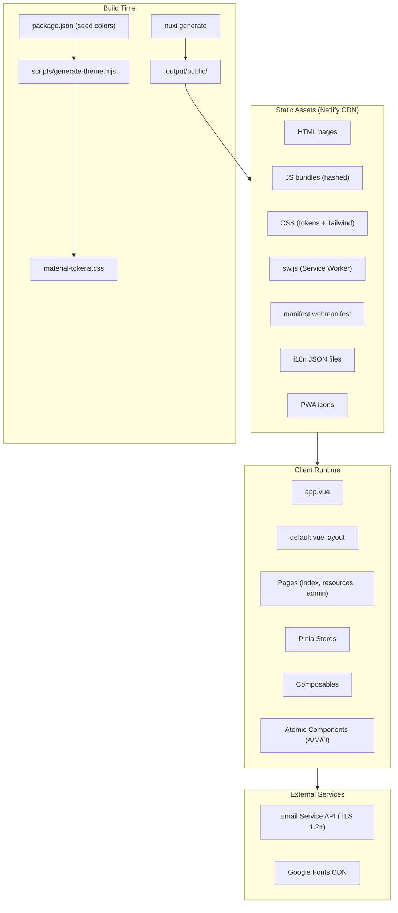
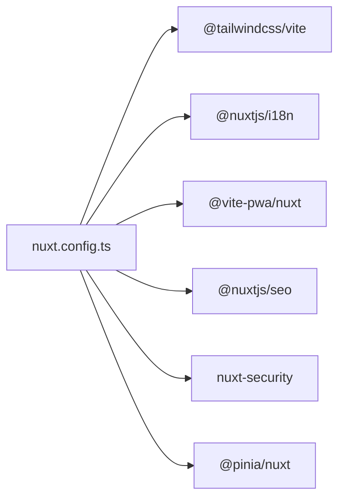
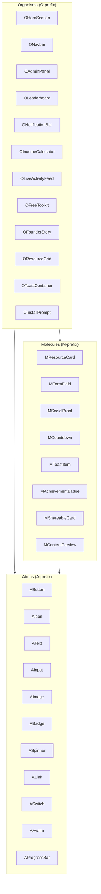
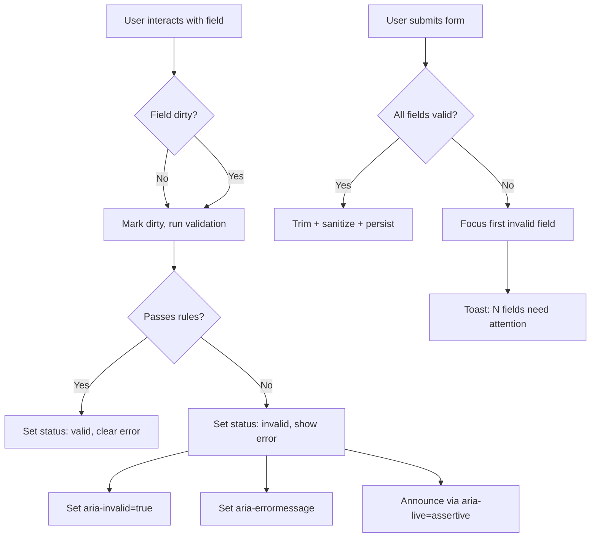

# Design Document: Money Conversion SPA

## Overview

The Money Conversion SPA is a Nuxt 4 statically-generated progressive web application that serves as a viral conversion-optimized platform for curated external money-making resource links. The application is built on an atomic component architecture with Material Design 3 tonal color system. It's content and UI architecture are structured around six viral psychology principles (Social Currency, Triggers, Emotion, Public Visibility, Practical Value, Stories) mapped to dedicated organism components, all

The system is fully static (deployed via `nuxi generate` → `.output/public` to Netlify), offline-capable via service worker, internationalized across three languages (en, es, am), and WCAG 2.2 AA compliant. An admin panel enables content management of resource links, while the public-facing interface maximizes engagement and sharing through conversion psychology patterns.

### Key Design Decisions

| Decision | Rationale |
|----------|-----------|
| Static generation (SSG) over SSR | No server runtime costs, CDN-edge delivery, simplified security model |
| Atomic Design with A/M/O prefixes | Enforces strict separation of concerns, predictable state management per tier |
| M3 tonal palettes from seed colors | Systematic color harmony across light/dark modes without manual palette curation |
| Tailwind v4 CSS-only config | No `tailwind.config.ts`; all theming in CSS `@theme` blocks for zero-JS color system |
| Pinia for global state only | Stores handle cross-cutting concerns (dark mode, PWA, toast); composables for instance logic |
| `useFormValidation` composable | Single declarative validation system reused across all forms, independently unit-testable |
| `utils/sanitize.ts` pure functions | Input sanitization as stateless utilities enables exhaustive property-based testing |
| Workbox runtime caching strategies | Granular cache policies per resource type maximize offline reliability |

---

## Architecture

### System Architecture



### Nuxt 4 Module Stack



### Request Flow (Service Worker Strategies)

| Resource Type | Strategy | Config |
|---------------|----------|--------|
| HTML pages | NetworkFirst | 3s timeout, fallback to cache |
| Hashed JS/CSS bundles | CacheFirst | 365-day expiration |
| Images | CacheFirst | 30-day expiration, max 60 entries |
| Translation JSON | StaleWhileRevalidate | Always fresh on next load |
| SW + Manifest | Network only | `Cache-Control: max-age=0, must-revalidate` |

---

## Components and Interfaces

### Atomic Component Tier Boundaries



### Key Interfaces

#### Resource Link Data Model

```typescript
interface ResourceLink {
  id: string
  title: string          // 3–100 chars
  description: string    // 10–500 chars
  category: string
  url: string            // https:// only, max 2048 chars
  thumbnail?: string     // JPEG/PNG/WebP, max 2MB
  displayOrder: number
  createdAt: string      // ISO 8601
  updatedAt: string      // ISO 8601
}
```

#### Toast Interface

```typescript
interface Toast {
  id: string
  type: 'success' | 'error' | 'warning' | 'info'
  message: string
  action?: string           // suggested corrective action (error toasts)
  duration: number          // default 5000ms
  remainingTime: number     // tracks pause/resume
  isPaused: boolean
}
```

#### Form Validation Composable

```typescript
interface ValidationRule {
  name: string
  validator: (value: unknown) => boolean
  message: string  // i18n key
}

interface FieldConfig {
  rules: ValidationRule[]
  maxLength?: number
  minLength?: number
}

interface UseFormValidation {
  fields: Record<string, FieldState>
  validate: (fieldName?: string) => boolean
  validateAll: () => boolean
  reset: () => void
  isValid: ComputedRef<boolean>
  firstInvalidField: ComputedRef<string | null>
  errorCount: ComputedRef<number>
}

interface FieldState {
  value: Ref<string>
  status: 'pristine' | 'dirty' | 'valid' | 'invalid'
  error: string | null
  touched: boolean
}
```

#### Sanitization Utility Module

```typescript
// utils/sanitize.ts — pure functions
export function sanitizeInput(input: string): string
export function sanitizeUrl(url: string): string | null
export function encodeForHtml(input: string): string
export function isValidHttpsUrl(url: string): boolean
export function stripDangerousTags(html: string): string
export function rejectControlChars(input: string): boolean
export function validateEmail(email: string): boolean
```

#### Pinia Stores

```typescript
// stores/darkMode.ts
interface DarkModeStore {
  isDark: boolean
  initialize(): void
  toggle(): void
}

// stores/pwaInstall.ts
interface PwaInstallStore {
  canInstall: boolean
  isDismissed: boolean
  isStandalone: boolean
  initialize(): void
  promptInstall(): Promise<void>
  dismiss(): void
}

// stores/toast.ts
interface ToastStore {
  toasts: Toast[]
  add(toast: Omit<Toast, 'id' | 'remainingTime' | 'isPaused'>): void
  remove(id: string): void
  pause(id: string): void
  resume(id: string): void
}

// stores/resources.ts
interface ResourceStore {
  links: ResourceLink[]
  categories: string[]
  isLoading: boolean
  error: string | null
  fetchAll(): Promise<void>
  create(link: Omit<ResourceLink, 'id' | 'createdAt' | 'updatedAt'>): Promise<void>
  update(id: string, data: Partial<ResourceLink>): Promise<void>
  delete(id: string): Promise<void>
  reorder(categoryId: string, orderedIds: string[]): Promise<void>
}
```

### Component-to-Viral-Principle Mapping

| Viral Principle | Organism | Purpose |
|----------------|----------|---------|
| Social Currency | `OLeaderboard`, `OExclusiveAccess` | Insider status, achievement badges, gated content |
| Triggers | `ONotificationBar`, `ODailyCheckIn` | Contextual reminders, habit loops |
| Emotion | `OIncomeCalculator`, `OCountdownTimer`, `OPainPoint` | Urgency, excitement, contrast |
| Public Visibility | `OLiveActivityFeed`, `OShareBadge`, `MSocialProof` | Social proof, observable behavior |
| Practical Value | `OFreeToolkit`, `OContentPreview`, `OShareableCard` | Utility, easy sharing |
| Stories | `OFounderStory`, `OSuccessStory`, `OCaseStudy` | Narrative, before/after |

---

## Data Models

### Resource Link Schema

```typescript
// Persisted in localStorage or JSON data file for static generation
interface ResourceLink {
  id: string                    // UUID v4
  title: string                 // min 3, max 100 chars
  description: string           // min 10, max 500 chars
  category: string              // non-empty category identifier
  url: string                   // valid https:// URL, max 2048 chars
  thumbnail: string | null      // base64 data URI or relative path, JPEG/PNG/WebP, max 2MB
  displayOrder: number          // integer for sorting within category
  isPublished: boolean          // admin can draft/publish
  createdAt: string             // ISO 8601 timestamp
  updatedAt: string             // ISO 8601 timestamp
}
```

### Content Block Schema

```typescript
interface ContentBlock {
  id: string
  categoryName: string           // display name
  categorySlug: string           // URL-safe identifier
  description: string
  displayOrder: number           // order among categories
  links: ResourceLink[]          // ordered by link.displayOrder
}
```

### User Engagement State (Client-side)

```typescript
interface EngagementState {
  badges: string[]               // earned badge identifiers
  lastVisit: string | null       // ISO 8601
  dailyCheckIns: number          // consecutive days
  sharesCount: number            // total shares performed
  installPromptDismissed: boolean
  preferredLocale: 'en' | 'es' | 'am'
}
```

### Toast Queue Model

```typescript
interface ToastQueueState {
  queue: Toast[]                 // max 3 visible
  history: Toast[]               // for debugging
}
```

### Theme Configuration (package.json)

```json
{
  "theme": {
    "primary": "#6750A4",
    "secondary": "#958DA5",
    "tertiary": "#7D5260"
  }
}
```

### i18n Locale Structure

```typescript
// i18n/locales/en.json shape
interface LocaleMessages {
  common: {
    appName: string
    loading: string
    error: string
    retry: string
    close: string
    save: string
    delete: string
    cancel: string
    confirm: string
  }
  validation: {
    required: string
    maxLength: string       // "Maximum {max} characters"
    minLength: string       // "Minimum {min} characters"
    invalidUrl: string
    invalidEmail: string
    fileTooLarge: string
    invalidFileType: string
    fieldsNeedAttention: string  // "{count} fields need attention"
  }
  toast: {
    linkCreated: string
    linkUpdated: string
    linkDeleted: string
    copySuccess: string
    shareSuccess: string
    installSuccess: string
    networkError: string
  }
  // ... additional domain keys
}
```

### File/Folder Architecture

```
├── .env                              # NUXT_PUBLIC_BASE_URL
├── .nvmrc                            # 22
├── .prettierrc                       # Prettier config
├── eslint.config.mjs                 # ESLint flat config
├── netlify.toml                      # Build + headers + redirects
├── package.json                      # theme seeds, scripts, exact versions
├── SECURITY.md                       # Accepted vulnerability overrides
├── scripts/
│   └── generate-theme.mjs           # M3 token generator
├── i18n/
│   └── locales/
│       ├── en.json
│       ├── es.json
│       └── am.json
├── public/
│   ├── favicon.svg
│   ├── offline.html                  # PWA offline fallback
│   └── icons/
│       ├── icon-192x192.png
│       ├── icon-512x512.png
│       └── icon-maskable-512x512.png
├── app/
│   ├── app.vue
│   ├── assets/css/
│   │   ├── main.css                  # Tailwind v4 @import + @theme + @variant
│   │   └── material-tokens.css       # Generated (DO NOT EDIT)
│   ├── components/
│   │   ├── atoms/
│   │   │   ├── AButton.vue
│   │   │   ├── AIcon.vue
│   │   │   ├── AText.vue
│   │   │   ├── AInput.vue
│   │   │   ├── AImage.vue
│   │   │   ├── ABadge.vue
│   │   │   ├── ASpinner.vue
│   │   │   ├── ALink.vue
│   │   │   ├── ASwitch.vue
│   │   │   ├── AAvatar.vue
│   │   │   ├── AProgressBar.vue
│   │   │   └── AChip.vue
│   │   ├── molecules/
│   │   │   ├── MResourceCard.vue
│   │   │   ├── MFormField.vue
│   │   │   ├── MSocialProof.vue
│   │   │   ├── MCountdown.vue
│   │   │   ├── MToastItem.vue
│   │   │   ├── MAchievementBadge.vue
│   │   │   ├── MShareableCard.vue
│   │   │   └── MContentPreview.vue
│   │   └── organisms/
│   │       ├── ONavbar.vue
│   │       ├── OHeroSection.vue
│   │       ├── OResourceGrid.vue
│   │       ├── OAdminPanel.vue
│   │       ├── OLeaderboard.vue
│   │       ├── ONotificationBar.vue
│   │       ├── ODailyCheckIn.vue
│   │       ├── OIncomeCalculator.vue
│   │       ├── OCountdownTimer.vue
│   │       ├── OLiveActivityFeed.vue
│   │       ├── OFreeToolkit.vue
│   │       ├── OFounderStory.vue
│   │       ├── OSuccessStory.vue
│   │       ├── OCaseStudy.vue
│   │       ├── OToastContainer.vue
│   │       ├── OInstallPrompt.vue
│   │       └── OFooter.vue
│   ├── composables/
│   │   ├── useFormValidation.ts      # Declarative form validation
│   │   ├── useToast.ts              # Toast trigger helper
│   │   ├── useScrollSpy.ts          # Scroll position tracking
│   │   └── useLocaleHead.ts         # i18n head meta
│   ├── stores/
│   │   ├── darkMode.ts
│   │   ├── pwaInstall.ts
│   │   ├── toast.ts
│   │   ├── resources.ts
│   │   └── engagement.ts
│   ├── utils/
│   │   ├── sanitize.ts              # Input sanitization pure functions
│   │   └── a11y.ts                  # Contrast ratio utilities
│   ├── layouts/
│   │   └── default.vue              # Skip-to-content, landmarks, focus mgmt
│   └── pages/
│       ├── index.vue                # Public landing + viral organisms
│       ├── resources.vue            # Resource grid by category
│       └── admin.vue                # Admin panel (auth-gated)
├── tests/
│   ├── unit/
│   │   ├── atoms/                   # Atom component tests
│   │   ├── molecules/               # Molecule component tests
│   │   ├── composables/             # useFormValidation tests
│   │   └── utils/                   # sanitize.ts property tests
│   └── e2e/
│       ├── navigation.spec.ts
│       ├── admin-crud.spec.ts
│       ├── pwa-install.spec.ts
│       └── accessibility.spec.ts
└── nuxt.config.ts
```


---

## Correctness Properties

*A property is a characteristic or behavior that should hold true across all valid executions of a system — essentially, a formal statement about what the system should do. Properties serve as the bridge between human-readable specifications and machine-verifiable correctness guarantees.*

### Property 1: Resource Link CRUD Round-Trip

*For any* valid ResourceLink object (title 3–100 chars, description 10–500 chars, valid https:// URL ≤ 2048 chars, non-empty category), creating or updating it via the resource store and then retrieving it should yield an equivalent object with all fields preserved.

**Validates: Requirements 1.2, 1.3**

### Property 2: URL Validation Rejects Non-HTTPS Protocols

*For any* string that does not begin with `https://` or does not conform to valid URL syntax per the WHATWG URL Standard, the URL validator (`isValidHttpsUrl` and `sanitizeUrl`) shall reject it — returning false or null respectively. Specifically, strings containing `javascript:`, `data:`, `vbscript:`, `http://`, `ftp://`, protocol-relative (`//`), or malformed syntax must all be rejected.

**Validates: Requirements 1.5, 20.5, 21.4**

### Property 3: Display Order Persistence

*For any* Content_Block with N Resource_Links and any valid permutation of those links, persisting the new order and then retrieving the links should yield them sorted by the updated displayOrder values matching the applied permutation.

**Validates: Requirements 1.6**

### Property 4: Invalid Form Fields Block Submission

*For any* form state where at least one required field is empty, exceeds its maximum character length, falls below its minimum character length, or fails its format validation rule, the form submission shall be blocked and no data shall be persisted.

**Validates: Requirements 1.7, 20.2, 20.8**

### Property 5: File Upload Validation

*For any* file metadata (MIME type string + file size in bytes), the file validator shall accept the file if and only if the MIME type is one of `image/jpeg`, `image/png`, or `image/webp` AND the file size is ≤ 2,097,152 bytes (2 MB). All other combinations shall be rejected.

**Validates: Requirements 1.8, 20.9**

### Property 6: Resource Grouping and Display Order

*For any* set of published Resource_Links with associated categories and displayOrder values, the public resource view shall group them by category and within each category the links shall appear in ascending displayOrder.

**Validates: Requirements 2.1**

### Property 7: Description Truncation

*For any* Resource_Link description string, the rendered card text shall equal the original string if its length is ≤ 150 characters, or equal the first 150 characters followed by "…" if its length exceeds 150 characters.

**Validates: Requirements 2.2**

### Property 8: Toast Timer Pause and Resume

*For any* toast with remaining auto-dismiss time T (where 0 < T ≤ 5000ms), pausing the timer shall freeze the remaining time at T, and resuming shall continue countdown from T. The total elapsed time from display to dismissal shall equal the sum of all unpaused intervals, always totaling the original duration.

**Validates: Requirements 7.5**

### Property 9: Toast Queue Maximum Visibility

*For any* sequence of toast add and remove operations, the number of visible toasts shall never exceed 3 at any point in time. When a 4th toast is added while 3 are visible, the oldest toast shall be removed before the new one appears.

**Validates: Requirements 7.7**

### Property 10: Income Calculator Correctness

*For any* valid set of income calculator inputs (numeric values for hours, rate, and multiplier within their defined ranges), the computed result shall equal the expected mathematical formula output, and the result shall be announced via an `aria-live="polite"` region.

**Validates: Requirements 10.1**

### Property 11: Activity Feed Throttle

*For any* sequence of activity feed updates with associated timestamps, the number of `aria-live` announcements within any 10-second window shall not exceed 1. Updates arriving within the throttle window shall be silently batched or dropped from announcement.

**Validates: Requirements 11.2**

### Property 12: Atomic Tier Enforcement

*For any* component file in `components/atoms/`, its filename must start with `A` and its source must not contain `ref(`, `reactive(`, `watch(`, `watchEffect(`, `onMounted(`, `onUnmounted(`, `onBeforeMount(`, `usePinia`, `useStore`, or `useState`. *For any* component file in `components/molecules/`, its filename must start with `M`, it must import only from `atoms/`, and must not contain `useFetch`, `useAsyncData`, `$fetch`, `useRoute`, `useRouter`, or store imports. *For any* component in `components/organisms/`, its filename must start with `O`.

**Validates: Requirements 14.2, 14.3, 14.4**

### Property 13: Theme Generation Produces Complete Palette

*For any* set of three valid 6-character hexadecimal seed colors (primary, secondary, tertiary), the theme generator shall output CSS custom properties covering all 26 tonal stops (0, 4, 6, 10, 12, 17, 20, 22, 24, 25, 30, 35, 40, 50, 60, 70, 80, 87, 90, 92, 94, 95, 96, 98, 99, 100) for each of the 6 color roles (primary, secondary, tertiary, neutral, neutral-variant, error), and each output value shall be a valid hex color string.

**Validates: Requirements 15.1**

### Property 14: M3 Semantic Color Contrast Meets WCAG AA

*For any* M3 semantic foreground/background token pairing (on-primary over primary, on-surface over surface, on-secondary over secondary, on-tertiary over tertiary, on-error over error, on-primary-container over primary-container, on-secondary-container over secondary-container, on-tertiary-container over tertiary-container, on-error-container over error-container), the computed contrast ratio shall be ≥ 4.5:1 for normal text and ≥ 3:1 for large text and non-text UI components, in both light mode (`:root`) and dark mode (`.dark`) schemes.

**Validates: Requirements 15.6, 16.11**

### Property 15: Invalid Hex Seed Rejection

*For any* string that is NOT a valid 6-character hexadecimal color code (wrong length, non-hex characters, missing `#` prefix, empty string), the theme generator shall exit with a non-zero status code and produce an error message identifying which seed value is invalid.

**Validates: Requirements 15.7**

### Property 16: Form Field ARIA Accessibility on Invalid State

*For any* form field in an invalid state (validation rule failed), the rendered field element shall have `aria-invalid="true"`, an associated `aria-errormessage` attribute pointing to a visible error element ID, and the error shall be announced via an `aria-live="assertive"` region.

**Validates: Requirements 16.5, 20.3**

### Property 17: Image Alt Text Compliance

*For any* `AImage` component render, if the image is informational (decorative=false), the `alt` attribute shall contain non-empty descriptive text. If the image is decorative (decorative=true), the `alt` attribute shall be exactly `""` or `role="presentation"` shall be present.

**Validates: Requirements 16.10**

### Property 18: Validation State Machine Transitions

*For any* form field managed by `useFormValidation`: it starts in `pristine` state (no error shown); upon first user interaction (blur/input) it transitions to `dirty`; once dirty, if the value passes all rules it becomes `valid`, if it fails any rule it becomes `invalid` with the error message shown within 100ms; when a previously invalid field's value is corrected to pass all rules, it transitions to `valid` with error message removed within 100ms.

**Validates: Requirements 20.1, 20.4, 20.11**

### Property 19: Email Validation

*For any* string, the email validator shall accept it if and only if it conforms to RFC 5322 simplified format (local@domain.tld) with a minimum domain length of 2 characters AND the domain is not on the configurable disposable-email blocklist. All other strings shall be rejected.

**Validates: Requirements 20.6, 21.7**

### Property 20: Character Count Display Threshold

*For any* field with a configured maximum character length M and any input string of length L: if L > 0.8 × M, the remaining character count (M − L) shall be displayed to the user. If L ≤ 0.8 × M, no character count shall be shown.

**Validates: Requirements 20.7**

### Property 21: Whitespace Trimming Before Validation

*For any* text input string with leading or trailing whitespace, the `useFormValidation` composable shall trim the whitespace before applying validation rules and before persistence. The trimmed value shall preserve all internal content (non-leading/trailing characters unchanged).

**Validates: Requirements 20.13**

### Property 22: HTML/Script Sanitization

*For any* input string containing HTML tags (`<script>`, `<iframe>`, `<object>`, `<embed>`, `<link>`, `<style>`), event handler attributes (`onclick`, `onerror`, `onload`, etc.), or `javascript:` protocol URIs, the `sanitizeInput` function shall return a string with all dangerous content removed while preserving safe plain-text content.

**Validates: Requirements 21.1**

### Property 23: HTML Entity Encoding Round-Trip

*For any* string containing characters `<`, `>`, `&`, `"`, `'`, the `encodeForHtml` function shall produce entity-encoded output (`&lt;`, `&gt;`, `&amp;`, `&quot;`, `&#x27;`). The encoding shall be idempotent: encoding an already-encoded string shall not double-encode entities.

**Validates: Requirements 21.2**

### Property 24: Control Character Rejection

*For any* string containing null bytes (`\0`), control characters (U+0000 through U+001F except U+0009 tab, U+000A newline, U+000D carriage return), or content exceeding the field's defined maximum byte length by 4×, the `rejectControlChars` function shall return true (indicating rejection).

**Validates: Requirements 21.5**

### Property 25: Rate Limiting

*For any* sequence of email-triggering form submissions from a single IP address, the first 3 submissions within any 15-minute sliding window shall succeed, and any subsequent submission within the same window shall be rejected with a 429 status. After the window expires, submissions shall succeed again.

**Validates: Requirements 21.9**

### Property 26: Audit Log Structure Excludes Raw Input

*For any* sanitization rejection event, the audit log entry shall contain a timestamp (ISO 8601), hashed IP address, field name, and rejection reason. The log entry shall NOT contain the raw malicious input content.

**Validates: Requirements 21.10**

### Property 27: Silent Sanitization

*For any* user input that is modified by the sanitization layer (tags stripped, content encoded), no toast notification shall be fired and no validation error shall be displayed to the user. The sanitized value shall be persisted silently. Only format/length violations that cannot be silently fixed shall produce user-visible errors.

**Validates: Requirements 21.12**

---

## Error Handling

### Error Categories and Responses

| Category | Source | User Feedback | Recovery |
|----------|--------|---------------|----------|
| Validation Error | Form input fails rules | Inline field error + summary toast | User corrects field |
| Network Error | Fetch/API call fails | Error toast with retry suggestion | Auto-retry with exponential backoff |
| Sanitization Rejection | Malicious input detected | Silent (no user notification) | Sanitized value persisted |
| Rate Limit Exceeded | Too many submissions | Warning toast (429) | Wait for window expiry |
| Theme Generation Failure | Invalid seed hex | Build exits non-zero with message | Developer fixes package.json |
| SW Cache Miss (Offline) | Page not cached | Offline fallback page | User reconnects |
| File Upload Error | Wrong type or too large | Field-specific validation error | User selects valid file |
| Audit Failure | Dependency vulnerability | Build exits non-zero | Developer updates package |

### Error Toast Pattern

All user-facing errors are routed through the Toast_System:
- **Type**: `error`
- **ARIA**: `role="alert"`, `aria-live="assertive"`
- **Content**: Failure reason + suggested corrective action
- **Duration**: 5s auto-dismiss (pauses on hover/focus)
- **Limit**: Max 3 visible toasts stacked

### Form Validation Error Flow



### Offline Error Handling

- NetworkFirst strategy with 3s timeout for pages
- On timeout: serve cached version silently
- On cache miss while offline: render `public/offline.html`
- No error toast for offline scenarios (user sees fallback page)

### Build-Time Error Handling

- `npm audit` failure (high/critical vulnerability) → non-zero exit, build aborted
- `npm audit` network failure → non-zero exit, build aborted
- Invalid theme seed hex → `generate-theme.mjs` exits non-zero with error message
- Missing test files → test runner exits non-zero

---

## Testing Strategy

### Testing Stack

| Tool | Purpose | Config |
|------|---------|--------|
| Vitest | Unit tests + property-based tests | `vitest.config.ts`, Vue Test Utils |
| fast-check | Property-based testing library | Arbitraries for domain types |
| @vue/test-utils | Component mounting + interaction | Paired with Vitest |
| Playwright | E2E cross-browser tests | Chromium, Firefox, WebKit |
| @vitest/coverage-v8 | Code coverage reporting | 80% threshold for atoms |

### Property-Based Testing Configuration

- **Library**: `fast-check` (TypeScript-native, integrates with Vitest)
- **Minimum iterations**: 100 per property test
- **Tag format**: `// Feature: money-conversion-spa, Property {N}: {title}`

Each correctness property maps to a single property-based test file:

```
tests/unit/
├── utils/
│   ├── sanitize.property.spec.ts     # Properties 22, 23, 24, 27
│   └── url-validation.property.spec.ts # Property 2
├── composables/
│   ├── form-validation.property.spec.ts # Properties 4, 16, 18, 20, 21
│   └── toast-timer.property.spec.ts    # Properties 8, 9
├── stores/
│   ├── resources.property.spec.ts     # Properties 1, 3, 6
│   └── rate-limit.property.spec.ts    # Property 25
├── theme/
│   └── generate-theme.property.spec.ts # Properties 13, 14, 15
└── components/
    ├── description-truncation.property.spec.ts # Property 7
    └── image-alt.property.spec.ts     # Property 17
```

### Unit Testing Strategy

Unit tests complement property tests by covering:
- **Atoms**: Props → render output, event emission, ARIA attributes present
- **Molecules**: State transitions (open/closed), child coordination, error state rendering
- **Composables**: Specific edge cases, integration between validation rules
- **Utils**: Known XSS payloads from OWASP, specific RFC 5322 edge cases

Coverage target: **80% line coverage** for all atom components.

### E2E Testing Strategy (Playwright)

```
tests/e2e/
├── navigation.spec.ts       # Route changes, focus management, keyboard nav
├── admin-crud.spec.ts       # Full admin CRUD flow with validation
├── pwa-install.spec.ts      # Install prompt, offline fallback
├── accessibility.spec.ts    # Tab order, aria-live, landmarks, contrast
├── i18n-switching.spec.ts   # Locale switching without reload
└── viral-organisms.spec.ts  # Leaderboard, calculator, share flows
```

E2E tests validate:
- All interactive elements reachable via Tab in logical order
- Focus moves to main content after route changes
- Dynamic content updates exposed via aria-live regions
- PWA install flow and offline behavior
- Admin content management end-to-end

### Test Scripts (package.json)

```json
{
  "scripts": {
    "test:unit": "vitest run",
    "test:e2e": "playwright test",
    "test:coverage": "vitest run --coverage",
    "test": "vitest run && playwright test"
  }
}
```

### Dual Testing Balance

- **Property tests** cover universal invariants (27 properties × 100+ iterations each)
- **Unit tests** cover specific examples, edge cases, accessibility rendering
- **E2E tests** cover user flows, keyboard navigation, cross-browser behavior
- Avoid redundant unit tests for cases already covered by properties (e.g., don't write 20 individual URL validation examples when Property 2 covers the full space)
